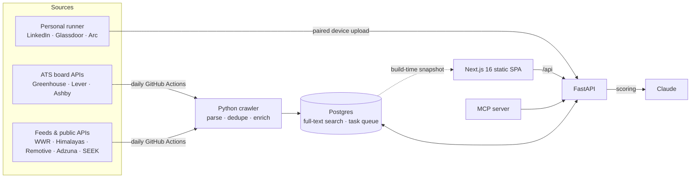

<div align="center">

# JobSeeking

**Every remote and relocation tech job, from every board, in one fast feed, and ranked against your CV.**

[](https://unified-job-crawler.vercel.app)
[](https://github.com/NoatToan/job-seeking/actions/workflows/ci.yml)


### [Try it live →](https://unified-job-crawler.vercel.app)

</div>

---

Job hunting across borders means a dozen tabs: LinkedIn, Seek, Glassdoor, We Work Remotely, Himalayas, company career pages. Each has its own filters, its own duplicates, and no idea whether you're even allowed to apply from your country.

**JobSeeking crawls them every morning, merges them into one catalogue, and answers the questions that actually matter:** *Can I apply from where I live? Do the hours overlap with my day? Does my stack fit? What does it pay?*

## Highlights

| | |
|---|---|
| **One feed, many boards** | Greenhouse, Lever and Ashby boards, We Work Remotely, Himalayas, Remotive, Adzuna, SEEK and Upwork, plus a personal browser runner for LinkedIn, Glassdoor and Arc. Every job shows where it came from. |
| **"Can I apply from here?"** | Each job carries its remote region and eligible countries, and tells you whether it's open to you. |
| **Hours that fit your life** | Working hours are converted to your timezone and labelled day or night shift, with a sun or moon icon. |
| **AI matching against your CV** | Upload a CV and Claude scores each job 0–100 with the reasons. Your feed sorts by fit. |
| **Fast with thousands of jobs** | A virtualised list keeps about 50 rows in the DOM at any time. Use ←/→ to step between jobs. Every filter lives in the URL, so a link restores the exact view. |
| **Built for search engines** | Static job pages with `JobPosting` JSON-LD, plus sitemaps, Open Graph images and a daily hiring-trends blog, rebuilt after every crawl. |
| **Bilingual** | English and Vietnamese, detected from the browser. |
| **Feedback built in** | Users point at any element, send feedback with a screenshot, and vote on ideas. Admins review it in the app. |

## Architecture



- **Postgres does all the work.** Weighted `tsvector` full-text search with a GIN index ranks jobs, and a `FOR UPDATE SKIP LOCKED` table serves as the background job queue. There's no Elasticsearch, Redis or broker to run.
- **API first, crawl last.** The crawler prefers official APIs and feeds. Sites without an API are only read from the user's own browser session, with no CAPTCHA bypass and no cookies stored on a server.
- **Static at runtime.** The web app is a static export, and only the build reads the database. Static job pages are prerendered from a snapshot and redeployed after each daily crawl.
- **Claude everywhere it helps.** It scores CVs against jobs through a pluggable provider (Anthropic API, local `claude` CLI, or a fake for tests), and an MCP server lets Claude search jobs live.

## Engineering

- **Monorepo:** `pnpm` workspaces for the TypeScript packages, `uv` for the three Python apps (API, crawler, MCP server).
- **CI on every PR:** typecheck, lint and tests for the web app; `ruff` and `pytest` for the Python apps; and every SQL migration applied from scratch against a real Postgres 17.
- **Automated daily:** the crawl runs at 05:00 and the blog at 06:30 (Vietnam time), then production is rebuilt with the Vercel CLI.
- **Security:** same-origin deployment behind Caddy, HttpOnly session cookies, double-submit CSRF tokens and a strict CSP. See [`docs/product/SECURITY.md`](docs/product/SECURITY.md).
- **Decisions recorded:** architecture decisions with their reasons are kept in [`docs/product/ARCHITECTURE.md`](docs/product/ARCHITECTURE.md) and [`docs/DECISIONS.md`](docs/DECISIONS.md).

## Tech stack

- **Frontend:** Next.js 16 (App Router, static export), React 19, Tailwind CSS 4, nuqs for URL state, Vitest
- **Backend:** FastAPI, Python 3.12, psycopg 3, Pydantic, httpx, Playwright (optional runner)
- **Data:** Postgres 17 with SQL migrations shared by every app
- **AI:** Claude for CV matching, plus an MCP server for live job search
- **Ops:** Vercel, GitHub Actions, Docker Compose with Caddy, Google Tag Manager and GA4

## Run it locally

```bash
pnpm install
cp .env.example .env.local      # set DATABASE_URL
pnpm db:migrate
pnpm dev                        # http://localhost:3000

cd apps/crawler && uv sync
uv run python -m job_crawler --dry-run   # fetch without writing
```

The full setup (deploy, workflows, blog sources, contributor sync, MCP and analytics) is in **[docs/DEVELOPMENT.md](docs/DEVELOPMENT.md)**.

## Repository map

| Path | What |
|---|---|
| [`apps/web`](apps/web) | Next.js web app |
| [`apps/api`](apps/api) | FastAPI backend and background worker |
| [`apps/crawler`](apps/crawler) | Source parsers, daily crawl, CV matching, blog ingestion |
| [`apps/mcp`](apps/mcp) | MCP server for live job search from Claude |
| [`packages/`](packages) | Shared TypeScript types and UI components |
| [`db/migrations`](db/migrations) | The single SQL schema |
| [`docs/`](docs) | PRD, architecture, design system, decisions |

---

<div align="center">

Built by **Tony Nguyen**. Open to work and happy to talk about how it's built.
**[See it live](https://unified-job-crawler.vercel.app)** · **[Read the architecture](docs/product/ARCHITECTURE.md)**

</div>
