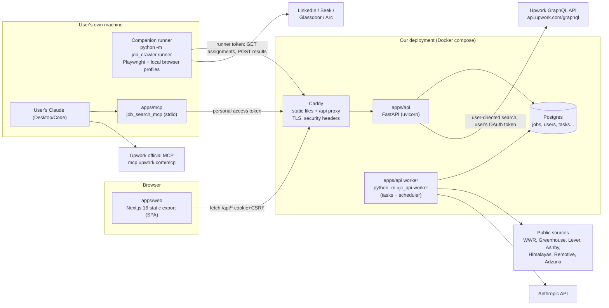
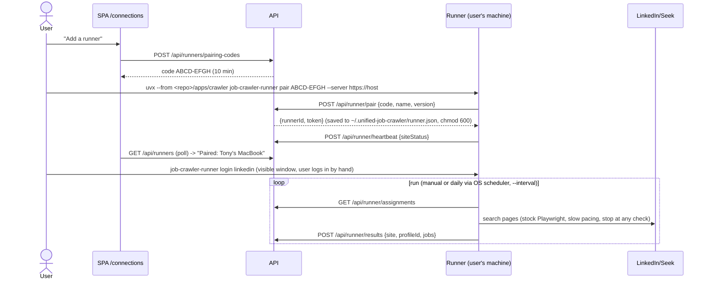

# Target architecture: job-seeking for individual users

Status: proposed (BA, 2026-10-29). This document is the contract the implementation issues in
[`backlog.json`](./backlog.json) build against. When an issue needs to change a contract here
(an endpoint shape, a table, an env var), the same PR updates this file.

## 1. Summary of decisions

| # | Decision | Why |
|---|---|---|
| D1 | **Next.js 16 static-export SPA** in `apps/web` (`output: 'export'`). All data comes from fetch calls to the API. The web app has no database access and no server code. | Tony asked for an SPA. It also gives one backend for web, MCP and the runner, and the static files can be served by any static host. |
| D2 | **FastAPI** in a new `apps/api` (Python 3.12, uv). It imports `job_crawler` as a path dependency, so the sources, eligibility and matching code are reused rather than rewritten. | The crawler and matching code is already Python. |
| D3 | **Postgres** stays the only datastore. A `tasks` table drained with `FOR UPDATE SKIP LOCKED` acts as the background job queue (`python -m ujc_api.worker`). | No Redis or broker to run. Scale is one deployment with tens to hundreds of users. |
| D4 | **Same-origin deployment**. A reverse proxy (Caddy) serves the SPA at `/` and proxies `/api/*` to FastAPI. Sessions use an HttpOnly cookie plus a double-submit CSRF token. | Cookies stay first-party and CORS is not needed in production. Static export cannot set headers itself, so Caddy sets them. |
| D5 | **Multi-user, single-person accounts.** Profiles, CVs, matches, applications, connections and runners are owned by a user. Public-source jobs are a shared catalogue. Jobs fetched with a user's own session or token are visible only to that user. | Several individuals can share one deployment without seeing each other's data, and we do not redistribute data obtained with someone's personal login. |
| D6 | **Upwork**: (a) the user's own Claude talks to **Upwork's official MCP server** (`https://mcp.upwork.com/mcp`), and we only document and link it. (b) In the app, a **user-directed live search** goes through the official GraphQL API with the user's OAuth token. Results are cached at most 24h, user-scoped, never scored by Claude, never in digests, and never polled on a schedule. We do **not** build an Upwork-wrapping MCP server. | Upwork's API & MCP Terms forbid continuous monitoring (§4.1), bulk extraction (§3.5), caching beyond 24h (§8.3) and using Upwork content to ground or evaluate AI (§5.3). Upwork launched an official MCP server on 2026-08-10, so wrapping the API again would add nothing. |
| D7 | **One MCP package, `apps/mcp` (`job_search_mcp`, merged in #1).** It already gives Claude free, live, on-demand search on SEEK (its public JSON search API), We Work Remotely (RSS) and Arc (`__NEXT_DATA__`). `.mcp.json` registers it next to `jobspy-mcp` (LinkedIn/Glassdoor/Indeed) and Upwork's official MCP (#33). M3-08 adds the user's *own* data tools to the same package (profiles, unified results, tracker), calling our REST API with a personal access token. | Satisfies "Upwork via MCP" and lets the user's Claude and our backend reuse one set of source clients, without a second MCP package. |
| D8 | **Session platforms** (LinkedIn, Glassdoor, Arc; Seek moves to its JSON search API, see D11) are crawled only by a **local companion runner** on the user's machine. It is paired to the account with a one-time code and uploads parsed jobs. Cookies and browser profiles never leave the machine. | This keeps the agreed constraints: no CAPTCHA bypass, no fingerprint spoofing, no server-side cookies. |
| D9 | **Pluggable LLM provider**: `anthropic` (Anthropic API, server default), `claude_cli` (local `claude -p`, for dev and the runner), `fake` (tests). Each user has a daily scoring quota. | A Claude consumer subscription on a server must not be used to serve other users, and API keys give cost control and concurrency. |
| D10 | **Work flow**: each GitHub issue gets a branch `feat/<key>-slug` and a PR with "Closes #n". **No Vercel deploy for now.** The Docker compose stack is the reference production target. | Tony's instruction. |
| D11 | **MCP/API-first, crawl last** (idea from #1). Fetch order: (1) official or public JSON APIs and feeds, queried **on demand** when a user searches (SEEK JSON API, Himalayas/Remotive search, WWR RSS, ATS board APIs, Arc pages); (2) the small daily scheduled crawl, only for open feeds and ATS boards (polite, cached); (3) the local browser runner, only for sources with no API (LinkedIn/Glassdoor when the user is logged in). Source clients live in one shared module used by `apps/mcp`, `apps/crawler` and `apps/api` (M3-09). | Fewer requests to job sites ("no crawler spam"), fresher results, no browser needed for SEEK, and one parser per source instead of copies in two apps. |

## 2. Component view



### Repository layout (target)

| Path | What | Status |
|---|---|---|
| `apps/web` | Next.js 16 SPA, `output: 'export'` | converted in M2-01 |
| `apps/api` | FastAPI app `ujc_api` (routers, repos, auth, tasks, worker, migrate) | new in M1-01 |
| `apps/crawler` | `job_crawler` library + CLIs (daily crawl, session, runner, matching, llm) | extended |
| `apps/mcp` | `job_search_mcp` stdio MCP server: live free sources (SEEK, WWR, Arc) today; user data tools over our REST API in M3-08 | exists (#1) |
| `packages/core` | TS types (API DTOs), source registry, country list | extended |
| `packages/ui` | shared React components | extended |
| `db/migrations` | SQL migrations (single schema) | 007+ added |
| `deploy/` | `Caddyfile`, `docker-compose.yml`, Dockerfiles | new in M5-02 |

### `apps/api` internal layout

```
apps/api/
  pyproject.toml            # deps: fastapi, uvicorn[standard], pydantic-settings, psycopg[binary,pool],
                            #   argon2-cffi, cryptography, httpx, python-multipart, job_crawler (path, editable)
  src/ujc_api/
    main.py                 # create_app(): middleware, routers, exception handlers
    settings.py             # pydantic-settings Settings (env vars below)
    db.py                   # psycopg ConnectionPool, get_conn dependency
    migrate.py              # applies db/migrations/*.sql, same schema_migrations table as scripts/migrate.mjs
    logging.py              # JSON logs, request id
    auth/                   # passwords.py, sessions.py, csrf.py, deps.py (current_user, runner, pat)
    routers/                # health, auth, me, profiles, jobs, sources, runs, platforms, connections,
                            #   upwork, runners, runner_api, cvs, matches, applications, tokens, digest
    repos/                  # SQL per aggregate (no ORM; plain psycopg like job_crawler.db)
    schemas/                # Pydantic request/response models (camelCase aliases)
    tasks/                  # queue.py (enqueue/claim/finish), handlers/*.py, scheduler.py
    worker.py               # python -m ujc_api.worker
    mail.py                 # Mailer protocol: console (dev) / SMTP (prod)
    crypto.py               # MultiFernet encrypt/decrypt for stored credentials
  tests/                    # pytest; uses TEST_DATABASE_URL, applies migrations once per session
```

There is no ORM. The repo already uses plain SQL with psycopg (`job_crawler/db.py`) and Postgres-specific
features (FTS, arrays, `SKIP LOCKED`), so we keep that approach.

## 3. SPA (apps/web) constraints

Static export (`node_modules/next/dist/docs/01-app/02-guides/static-exports.md`) does **not** support
Server Actions, cookies(), Route Handlers that read the Request, rewrites, redirects, headers, proxy, ISR,
or dynamic routes without `generateStaticParams`. Therefore:

- Every page is a client component tree that fetches from `/api`. Delete `src/lib/db.ts`, `jobs.ts`,
  `profiles.ts`, `app/profiles/actions.ts`, and `app/api/health/route.ts` (the API owns health).
- **No dynamic segments.** Use query params: `/profiles/view?id=7`, `/profiles/edit?id=7`,
  `/jobs/view?id=123`. Read them with `useSearchParams()` inside a `<Suspense>` boundary.
- Remove `cacheComponents` and `partialPrefetching` from `next.config.ts`. They target server rendering
  and would mislead future contributors. Remove `postgres` and `server-only` from dependencies. Remove
  `node ../../scripts/migrate.mjs &&` from the web build: migrations belong to the API deploy.
- `NEXT_PUBLIC_API_BASE_URL` defaults to `""` (same origin, so calls go to `/api/...`). In dev it is
  `http://localhost:8000`, and the API allows that origin with credentials. `localhost:3000` and
  `localhost:8000` are the *same site*, so `SameSite=Lax` cookies are sent.
- `src/lib/api.ts` is a typed fetch client. It sends `credentials: 'include'`, adds `X-CSRF-Token` from
  the `ujc_csrf` cookie on non-GET requests, maps the error body to an `ApiError`, and treats 401 as a
  redirect to `/login?next=...`.
- Data fetching: a small `useApi(key, fn)` hook (or TanStack Query, if the engineer prefers; decide in
  M2-01 and record it here). Task polling uses `GET /api/tasks/{id}` every 2s with backoff.
- Security headers (CSP, frame-ancestors, etc.) are set in `deploy/Caddyfile`, not in Next.

## 4. Data model changes

Existing tables are kept (`jobs`, `company_boards`, `crawl_runs`, `search_profiles`, `profile_jobs`, `cvs`,
`cv_matches`). Migration numbers are **reserved per issue** so parallel PRs never collide:

| File | Issue | Content |
|---|---|---|
| `007_users_auth.sql` | M1-02 | `users`, `sessions`, `email_tokens` |
| `008_ownership.sql` | M1-04 | owner columns + visibility (below) |
| `009_tasks.sql` | M1-07 | `tasks` |
| `010_platform_connections.sql` | M3-01 | `platform_connections` |
| `011_runners.sql` | M3-06 | `runners`, `runner_pairing_codes` |
| `012_upwork_cache.sql` | M3-04 | `upwork_search_cache` |
| `013_cv_lifecycle.sql` | M4-02 | CV status/consent columns |
| `014_applications.sql` | M4-05 | `applications`, `application_events` |
| `015_digest.sql` | M4-08 | digest settings + `digest_deliveries` |
| `016_personal_access_tokens.sql` | M3-08 | `personal_access_tokens` |
| `017_audit_privacy.sql` | M5-04 | `audit_log`, `consents` |

The migration runner applies any file not yet in `schema_migrations`, in name order. So a higher number
merging first is fine as long as it does not depend on a lower one that has not merged yet.

### 007_users_auth.sql
```sql
CREATE EXTENSION IF NOT EXISTS citext;
CREATE TABLE users (
  id                BIGSERIAL PRIMARY KEY,
  email             CITEXT      NOT NULL UNIQUE,
  password_hash     TEXT        NOT NULL,             -- argon2id
  display_name      TEXT,
  country           TEXT,                             -- ISO code, default for new profiles' candidate_country
  timezone          TEXT        NOT NULL DEFAULT 'Asia/Ho_Chi_Minh',
  locale            TEXT        NOT NULL DEFAULT 'en',  -- 'en' | 'vi' (Claude reasons language)
  email_verified_at TIMESTAMPTZ,
  is_admin          BOOLEAN     NOT NULL DEFAULT FALSE,
  created_at        TIMESTAMPTZ NOT NULL DEFAULT now(),
  updated_at        TIMESTAMPTZ NOT NULL DEFAULT now()
);
CREATE TABLE sessions (
  id           BIGSERIAL PRIMARY KEY,
  token_hash   BYTEA       NOT NULL UNIQUE,           -- sha256 of the cookie value, never the token itself
  user_id      BIGINT      NOT NULL REFERENCES users (id) ON DELETE CASCADE,
  created_at   TIMESTAMPTZ NOT NULL DEFAULT now(),
  last_seen_at TIMESTAMPTZ NOT NULL DEFAULT now(),
  expires_at   TIMESTAMPTZ NOT NULL,
  user_agent   TEXT,
  ip           INET
);
CREATE INDEX sessions_user_idx ON sessions (user_id);
CREATE TABLE email_tokens (
  token_hash BYTEA       PRIMARY KEY,
  user_id    BIGINT      NOT NULL REFERENCES users (id) ON DELETE CASCADE,
  purpose    TEXT        NOT NULL CHECK (purpose IN ('verify_email', 'reset_password', 'unsubscribe')),
  expires_at TIMESTAMPTZ NOT NULL,
  used_at    TIMESTAMPTZ
);
```

### 008_ownership.sql
```sql
ALTER TABLE search_profiles ADD COLUMN user_id BIGINT REFERENCES users (id) ON DELETE CASCADE;
CREATE INDEX search_profiles_user_idx ON search_profiles (user_id);
ALTER TABLE cvs ADD COLUMN user_id BIGINT REFERENCES users (id) ON DELETE CASCADE;
ALTER TABLE cvs ALTER COLUMN profile_id DROP NOT NULL;   -- a CV belongs to the user; matching picks (profile, cv)
ALTER TABLE crawl_runs ADD COLUMN user_id BIGINT REFERENCES users (id) ON DELETE CASCADE;   -- NULL = global crawl
ALTER TABLE crawl_runs ADD COLUMN profile_id BIGINT REFERENCES search_profiles (id) ON DELETE SET NULL;
ALTER TABLE crawl_runs ADD COLUMN trigger TEXT NOT NULL DEFAULT 'schedule'
  CHECK (trigger IN ('schedule', 'manual', 'runner'));
-- Jobs fetched with a user's own session (runner) are visible only to that user.
ALTER TABLE jobs ADD COLUMN owner_user_id BIGINT REFERENCES users (id) ON DELETE CASCADE;   -- NULL = public catalogue
ALTER TABLE jobs DROP CONSTRAINT jobs_source_external_id_key;
CREATE UNIQUE INDEX jobs_dedupe_idx ON jobs (source, external_id, coalesce(owner_user_id, 0));
CREATE INDEX jobs_owner_idx ON jobs (owner_user_id) WHERE owner_user_id IS NOT NULL;
```
Existing rows keep `user_id NULL`. `python -m ujc_api.admin claim-legacy --email <e>` assigns orphan profiles
and CVs to one user, and assigns session-source jobs (`linkedin`, `seek`, `arc`, `glassdoor`) as owned by
that user. After that, API queries treat `user_id IS NULL` profiles as invisible. `job_crawler.db.upsert_jobs`
gets an `owner_user_id` parameter (default `None`), and its `ON CONFLICT` target changes to the new index
expression.

**Visibility rule** (one SQL fragment in `repos/jobs.py`): `jobs.owner_user_id IS NULL OR jobs.owner_user_id = :me`.

### 009_tasks.sql
```sql
CREATE TABLE tasks (
  id           BIGSERIAL PRIMARY KEY,
  kind         TEXT        NOT NULL,          -- global_crawl | profile_search | cv_extract | match_score | digest | purge
  payload      JSONB       NOT NULL DEFAULT '{}',
  user_id      BIGINT      REFERENCES users (id) ON DELETE CASCADE,
  status       TEXT        NOT NULL DEFAULT 'queued'
               CHECK (status IN ('queued', 'running', 'done', 'failed', 'cancelled')),
  dedupe_key   TEXT,                          -- e.g. 'profile_search:42', 'digest:7:2026-10-29'
  attempts     INTEGER     NOT NULL DEFAULT 0,
  max_attempts INTEGER     NOT NULL DEFAULT 3,
  run_after    TIMESTAMPTZ NOT NULL DEFAULT now(),
  locked_by    TEXT,
  locked_at    TIMESTAMPTZ,
  progress     JSONB,                         -- {"step": "scoring", "done": 8, "total": 24}
  result       JSONB,
  error        TEXT,
  created_at   TIMESTAMPTZ NOT NULL DEFAULT now(),
  finished_at  TIMESTAMPTZ
);
CREATE INDEX tasks_ready_idx ON tasks (run_after) WHERE status = 'queued';
CREATE UNIQUE INDEX tasks_active_dedupe_idx ON tasks (dedupe_key) WHERE status IN ('queued', 'running');
```
The worker claims work with `UPDATE tasks SET status='running' ... WHERE id = (SELECT id FROM tasks WHERE
status='queued' AND run_after <= now() ORDER BY run_after FOR UPDATE SKIP LOCKED LIMIT 1) RETURNING *`.
Failures retry with exponential backoff until `max_attempts`. A task left `running` more than 30 min after
`locked_at` is requeued. Every minute the scheduler enqueues periodic tasks idempotently via `dedupe_key`:

- `global_crawl` daily at 22:00 UTC. This replaces `.github/workflows/daily-crawl.yml` once deployed.
- `digest` per user at their local hour.
- `purge` hourly: expired sessions, tokens, Upwork cache and CV retention.

### 010_platform_connections.sql
```sql
CREATE TABLE platform_connections (
  id                  BIGSERIAL PRIMARY KEY,
  user_id             BIGINT      NOT NULL REFERENCES users (id) ON DELETE CASCADE,
  platform            TEXT        NOT NULL,             -- 'upwork' | 'adzuna'
  status              TEXT        NOT NULL CHECK (status IN ('connected', 'error', 'revoked')),
  credentials         BYTEA       NOT NULL,             -- MultiFernet-encrypted JSON (tokens / api keys)
  scopes              TEXT[]      NOT NULL DEFAULT '{}',
  external_account    TEXT,                             -- e.g. Upwork user id / display name
  expires_at          TIMESTAMPTZ,                      -- access token expiry
  last_used_at        TIMESTAMPTZ,
  last_error          TEXT,
  created_at          TIMESTAMPTZ NOT NULL DEFAULT now(),
  updated_at          TIMESTAMPTZ NOT NULL DEFAULT now(),
  UNIQUE (user_id, platform)
);
```

### 011_runners.sql
```sql
CREATE TABLE runners (
  id           BIGSERIAL PRIMARY KEY,
  user_id      BIGINT      NOT NULL REFERENCES users (id) ON DELETE CASCADE,
  name         TEXT        NOT NULL,                    -- "Tony's MacBook"
  token_hash   BYTEA       NOT NULL UNIQUE,
  version      TEXT,
  site_status  JSONB       NOT NULL DEFAULT '{}',       -- {"linkedin": "logged_in", "seek": "needs_login", ...}
  paired_at    TIMESTAMPTZ NOT NULL DEFAULT now(),
  last_seen_at TIMESTAMPTZ,
  revoked_at   TIMESTAMPTZ
);
CREATE TABLE runner_pairing_codes (
  code_hash  BYTEA       PRIMARY KEY,
  user_id    BIGINT      NOT NULL REFERENCES users (id) ON DELETE CASCADE,
  expires_at TIMESTAMPTZ NOT NULL,                      -- 10 minutes
  used_at    TIMESTAMPTZ
);
CREATE TABLE runner_requests (                          -- "Run now" from the web app
  id          BIGSERIAL PRIMARY KEY,
  user_id     BIGINT      NOT NULL REFERENCES users (id) ON DELETE CASCADE,
  profile_id  BIGINT      REFERENCES search_profiles (id) ON DELETE CASCADE,
  sites       TEXT[]      NOT NULL DEFAULT '{}',
  status      TEXT        NOT NULL DEFAULT 'pending' CHECK (status IN ('pending', 'claimed', 'done', 'failed')),
  runner_id   BIGINT      REFERENCES runners (id) ON DELETE SET NULL,
  created_at  TIMESTAMPTZ NOT NULL DEFAULT now(),
  finished_at TIMESTAMPTZ
);
```

### 012_upwork_cache.sql
```sql
CREATE TABLE upwork_search_cache (       -- Upwork API & MCP Terms §8.3: max 24h, then delete
  id          BIGSERIAL PRIMARY KEY,
  user_id     BIGINT      NOT NULL REFERENCES users (id) ON DELETE CASCADE,
  query_hash  BYTEA       NOT NULL,
  query       JSONB       NOT NULL,
  results     JSONB       NOT NULL,
  fetched_at  TIMESTAMPTZ NOT NULL DEFAULT now(),
  expires_at  TIMESTAMPTZ NOT NULL,      -- fetched_at + 24h, never extended without a real user search
  UNIQUE (user_id, query_hash)
);
```

### 013_cv_lifecycle.sql
```sql
ALTER TABLE cvs ADD COLUMN status TEXT NOT NULL DEFAULT 'ready'
  CHECK (status IN ('uploaded', 'extracting', 'ready', 'failed'));
ALTER TABLE cvs ADD COLUMN error TEXT;
ALTER TABLE cvs ADD COLUMN size_bytes INTEGER;
ALTER TABLE cvs ADD COLUMN ai_consent_at TIMESTAMPTZ;        -- consent to send CV text to the LLM provider (cross-border)
ALTER TABLE cvs ADD COLUMN last_used_at TIMESTAMPTZ;         -- retention clock
ALTER TABLE cvs ALTER COLUMN text DROP NOT NULL;             -- filled by the extraction task
ALTER TABLE cvs ALTER COLUMN extracted DROP NOT NULL;
ALTER TABLE cv_matches ADD COLUMN profile_id BIGINT REFERENCES search_profiles (id) ON DELETE CASCADE;
```
The original file is **not stored**. It is parsed in memory or in a temp file and then discarded. Only the
text and the extracted profile are kept.

### 014_applications.sql
```sql
CREATE TABLE applications (
  id             BIGSERIAL PRIMARY KEY,
  user_id        BIGINT      NOT NULL REFERENCES users (id) ON DELETE CASCADE,
  job_id         BIGINT      REFERENCES jobs (id) ON DELETE SET NULL,
  -- snapshot so the card survives job deletion, and so Upwork / manual entries need no jobs row
  source         TEXT        NOT NULL,
  external_url   TEXT        NOT NULL,
  title          TEXT        NOT NULL,
  company        TEXT,
  status         TEXT        NOT NULL DEFAULT 'saved'
                 CHECK (status IN ('saved', 'applied', 'interviewing', 'offer', 'rejected', 'withdrawn', 'hidden')),
  cv_id          BIGINT      REFERENCES cvs (id) ON DELETE SET NULL,
  notes          TEXT,
  applied_at     TIMESTAMPTZ,
  next_action_at TIMESTAMPTZ,
  created_at     TIMESTAMPTZ NOT NULL DEFAULT now(),
  updated_at     TIMESTAMPTZ NOT NULL DEFAULT now()
);
CREATE UNIQUE INDEX applications_user_job_idx ON applications (user_id, job_id) WHERE job_id IS NOT NULL;
CREATE TABLE application_events (
  id             BIGSERIAL PRIMARY KEY,
  application_id BIGINT      NOT NULL REFERENCES applications (id) ON DELETE CASCADE,
  from_status    TEXT,
  to_status      TEXT        NOT NULL,
  note           TEXT,
  created_at     TIMESTAMPTZ NOT NULL DEFAULT now()
);
```

### 015_digest.sql
```sql
ALTER TABLE users ADD COLUMN digest_enabled BOOLEAN NOT NULL DEFAULT TRUE;
ALTER TABLE users ADD COLUMN digest_hour SMALLINT NOT NULL DEFAULT 7 CHECK (digest_hour BETWEEN 0 AND 23);
ALTER TABLE users ADD COLUMN digest_min_score SMALLINT NOT NULL DEFAULT 60;
CREATE TABLE digest_deliveries (
  id        BIGSERIAL PRIMARY KEY,
  user_id   BIGINT      NOT NULL REFERENCES users (id) ON DELETE CASCADE,
  sent_on   DATE        NOT NULL,
  job_ids   BIGINT[]    NOT NULL,
  status    TEXT        NOT NULL CHECK (status IN ('sent', 'skipped_empty', 'failed')),
  error     TEXT,
  UNIQUE (user_id, sent_on)
);
```

### 016_personal_access_tokens.sql and 017_audit_privacy.sql
`personal_access_tokens(id, user_id, name, token_hash, scopes text[], created_at, last_used_at, expires_at,
revoked_at)`: tokens are shown once and stored as a sha256 hash, with scopes `jobs:read`, `profiles:read` and
`applications:write`.
`audit_log(id, user_id, action, ip, user_agent, meta jsonb, created_at)` records login, failed login, password
change, connection added or removed, runner paired or revoked, data export and account deletion.
`consents(id, user_id, purpose, version, granted_at, withdrawn_at)` has purposes `terms`, `privacy`,
`ai_processing` and `digest_email`.

## 5. API surface (REST/JSON, prefix `/api`)

Conventions:
- JSON bodies use camelCase (Pydantic `alias_generator=to_camel`, `populate_by_name=True`).
- IDs are strings.
- Lists return `{ "items": [...], "total": n, "page": p, "pageSize": s }`.
- Errors return `{ "error": { "code": "snake_case", "message": "human text", "fields"?: {...} } }` with a proper
  status (400 validation, 401 unauthenticated, 403 forbidden/CSRF, 404 not found **or not yours**, 409 conflict,
  413 too large, 422 unprocessable, 429 rate limited with `Retry-After`, 503 dependency down).
- Background work returns `202 { "taskId": "..." }`, and `GET /api/tasks/{id}` reports progress.

| Method & path | Auth | Purpose | Issue |
|---|---|---|---|
| `GET /api/health` | none | liveness `{status:"ok", version}` | M1-01 |
| `GET /api/ready` | none | DB reachable + migrations applied | M1-01 |
| `POST /api/auth/register` | none | `{email, password, displayName?, acceptTerms:true}` → 201 + session cookie | M1-02 |
| `POST /api/auth/login` | none | `{email, password}` → 200 + session cookie | M1-02 |
| `POST /api/auth/logout` | session | delete session | M1-02 |
| `GET /api/auth/me` | session | current user or 401; also sets `ujc_csrf` cookie | M1-02 |
| `POST /api/auth/change-password` | session | `{currentPassword, newPassword}`; revokes other sessions | M1-02 |
| `POST /api/auth/verify-email` | none | `{token}` | M1-03 |
| `POST /api/auth/resend-verification` | session | | M1-03 |
| `POST /api/auth/forgot-password` | none | `{email}` → always 202 (no user enumeration) | M1-03 |
| `POST /api/auth/reset-password` | none | `{token, newPassword}`; revokes all sessions | M1-03 |
| `GET /api/me/settings`, `PATCH /api/me/settings` | session | country, timezone, locale, digest settings | M1-02 / M4-08 |
| `GET /api/me/export` | session | JSON export of all the user's data | M5-04 |
| `DELETE /api/me` | session + password | delete the account and everything owned (cascade) | M5-04 |
| `GET /api/profiles` · `POST /api/profiles` | session | list / create (≤ 20 per user) | M1-05 |
| `GET/PATCH/DELETE /api/profiles/{id}` | session | owner only | M1-05 |
| `GET /api/profiles/{id}/jobs` | session | unified results: `q, source, remote, minScore, cvId, status, page`; each item has `match` and `application` | M1-06 |
| `POST /api/profiles/{id}/search` | session | enqueue `profile_search` (public keyword APIs + Adzuna) → 202 | M3-05 |
| `POST /api/profiles/{id}/runner-requests` | session | ask the paired runner to crawl session sites now | M3-06 |
| `GET /api/jobs` | optional | browse public catalogue (+ own jobs if signed in): `q, source, remote, page` | M1-06 |
| `GET /api/jobs/{id}` | optional | job detail incl. description; 404 if not visible | M1-06 |
| `GET /api/sources` | none | source catalogue + latest global run per source | M1-06 |
| `GET /api/runs` | session | the user's crawl runs (`profileId?`) | M3-05 |
| `GET /api/tasks/{id}` | session | `{status, progress, result, error}` (own tasks only) | M3-05 |
| `GET /api/platforms` | session | catalogue: `{id, label, kind: public|api_key|oauth|runner, connectState, available}` | M3-01 |
| `PUT /api/connections/adzuna` | session | `{appId, appKey}` → validated by a test call, stored encrypted | M3-01 |
| `DELETE /api/connections/{platform}` | session | disconnect (Upwork: also revoke the token) | M3-01 |
| `GET /api/connections/upwork/authorize` | session | 302 to Upwork OAuth (PKCE, `state` bound to session) | M3-04 |
| `GET /api/connections/upwork/callback` | session | exchange code, store tokens, 302 to `/connections?upwork=connected` | M3-04 |
| `POST /api/upwork/search` | session | user-directed live search `{q, profileId?, cursor?}` → results (cache ≤ 24h) | M3-04 |
| `POST /api/runners/pairing-codes` | session | → `{code: "ABCD-EFGH", expiresAt}` | M3-06 |
| `GET /api/runners` · `DELETE /api/runners/{id}` | session | list / revoke | M3-06 |
| `POST /api/runner/pair` | pairing code | `{code, name, version}` → `{runnerId, token}` (token shown once) | M3-06 |
| `GET /api/runner/assignments` | runner token | profiles (`id, name, keywords, locations, remoteOnly, sources`) + pending runner requests | M3-06 |
| `POST /api/runner/heartbeat` | runner token | `{version, siteStatus}` | M3-06 |
| `POST /api/runner/results` | runner token | `{site, profileId, requestId?, jobs: JobRecord[], error?}` (≤ 500 jobs, ≤ 2 MB) | M3-06 |
| `POST /api/cvs` | session | multipart `file` + `aiConsent=true` → 202 `{cvId, taskId}` | M4-02 |
| `GET /api/cvs` · `GET /api/cvs/{id}` · `DELETE /api/cvs/{id}` | session | list / detail (extracted profile, no raw text by default) / delete | M4-02 |
| `POST /api/profiles/{id}/match` | session | `{cvId, limit≤60, preferences?}` → 202 task | M4-03 |
| `GET /api/applications` · `POST /api/applications` | session | list (`status`) / create from `jobId`, or manual `{source,url,title,company}` | M4-05 |
| `PATCH/DELETE /api/applications/{id}` | session | status, notes, nextActionAt, cvId (status change writes an event) | M4-05 |
| `GET /api/applications/{id}/events` | session | history | M4-05 |
| `POST /api/digest/unsubscribe` | token | one-click unsubscribe (RFC 8058 `List-Unsubscribe-Post`) | M4-08 |
| `GET/POST/DELETE /api/tokens` | session | personal access tokens for MCP | M3-08 |

DTO shapes for jobs extend the existing `Job` interface in `packages/core/src/index.ts`. M2-01 moves
`JobFilters`, `Page<T>`, `ApiErrorBody`, `SearchProfile`, `User` and the other DTOs into `packages/core/src/api.ts`
so web and docs share one definition. FastAPI's OpenAPI (`/api/openapi.json`, served only when `UJC_ENV != production`)
is the source of truth for request validation.

## 6. Platform connection model

| Kind | Platforms | "Connect" means | Where credentials live | How jobs arrive |
|---|---|---|---|---|
| `public` | We Work Remotely, Greenhouse, Lever, Ashby, Himalayas, Remotive | Nothing; always on. The user can untick them per profile. | none | Daily `global_crawl` task (shared catalogue) + per-profile keyword search (Himalayas, Remotive) on "Run search" and daily. Remotive stays capped (few calls/day across the deployment). |
| `api_key` | Adzuna | Optional: the operator key (`ADZUNA_APP_ID/KEY`) powers the global crawl. A user may add their own app id/key for per-profile searches in more countries. | Encrypted in `platform_connections` | `profile_search` task; Adzuna attribution shown on every Adzuna job (badge + "Jobs by Adzuna" link). |
| `oauth` | Upwork | OAuth 2.0 authorization code with PKCE, scopes "Read marketplace Job Postings" + "Common Entities - Read-Only". Needs **our app's approved API key**. | Access token (24h) + refresh token (2 weeks after last use), encrypted in `platform_connections` | **Only** on explicit user action (`POST /api/upwork/search`). Results go to `upwork_search_cache` (≤ 24h), are shown in a separate, clearly-attributed "Upwork (live)" panel, and are never written to `jobs`. |
| `runner` | LinkedIn, Seek, Glassdoor, Arc | Pair a companion runner, then log in to each site **in the runner's own browser window**. | Browser profile on the user's machine (`~/.unified-job-crawler/<site>`). The server only holds a hashed runner token. | Runner pulls assignments, crawls slowly with the existing `session` engine, uploads parsed `JobRecord`s. The API upserts them with `owner_user_id = runner.user_id` and links `profile_jobs`. |

### Companion runner pairing



Runner rules:
- Runner tokens are scoped. They can read only the owner's profile search fields and write only results.
  They can never read CVs, matches or other data.
- The runner never sends cookies, HTML pages or screenshots, only parsed `JobRecord` fields.
  `raw` is dropped server-side for session sources.
- The server re-validates every uploaded job (Pydantic `JobRecord`, URL host must match the site's domain list,
  max 500 per call) and rate-limits the endpoint (60/hour per runner).
- When a site shows a CAPTCHA or login wall, the behaviour is unchanged. Headed mode waits for the user;
  headless mode stops and reports `siteStatus[site] = "needs_attention"`, which the web app shows on the
  connection card.

## 7. Upwork plan (detail)

What we learned (sources: Upwork API & MCP Terms PDF `upwork.pactsafe.io/versions/6a7de807acdc47dbc84c4892.pdf`,
developer docs, Upwork press release 2026-08-10):

- **API**: GraphQL at `https://api.upwork.com/graphql`, OAuth2 (Authorization Code with PKCE for normal accounts;
  Client Credentials is enterprise-only). Access token TTL is 24h; the refresh token lasts 2 weeks after last use.
  Search query is `marketplaceJobPostingsSearch(marketPlaceJobFilter: {searchExpression_eq, skillExpression_eq,
  categoryIds_any, budgetRange_eq, pagination_eq {after, first}}, searchType)`. The older `marketplaceJobPostings`
  is deprecated. Limit is about 40,000 requests/day per key, and 429 on excess (per-minute limits unverified:
  design for backoff).
- **Key approval**: apply at `upwork.com/developer/keys/apply` from an Upwork account in good standing
  (freelancers need JSS ≥ 90%). The application must describe the app (internal or public), our role and expected
  volume. Review takes about 1 week. Scopes are chosen per key.
- **Terms that shape the design**: user-directed tasks only, no enumeration or continuous monitoring (§4.1);
  no bulk extraction or indexing (§3.5); cache ≤ 24h then delete, no re-fetch just to refresh (§8.3); keep
  attribution and do not blend Upwork into third-party results so that the source is hidden (§3.4, §5.12(c));
  no competing service and no scoring system built from API data (§3.2, §5.12(a)); no scraping or headless
  browsing (§5.2); **no using Upwork content to train, retrieval-augment, evaluate or benchmark AI** (§5.3); no
  multiple apps or accounts to dodge limits (§7.2).
- **Official MCP**: `https://mcp.upwork.com/mcp` (Streamable HTTP, OAuth 2.1, free) covers job search, saved
  jobs, recommendations, proposals and messages, with confirmation for consequential actions. Custom MCP clients may
  fail dynamic client registration, so we treat it as **for the user's own Claude**, not for our backend.
- RSS feeds were discontinued in August 2024, so they are not an alternative. Community MCP servers either wrap the
  API (one was archived in favour of the official server) or automate the browser (prohibited by §5.2).

Therefore:

1. **Now, no key needed (M3-03, M3-08, M3-02):**
   - Build `job_crawler/sources/upwork.py` (GraphQL client + mapping) against recorded fixture JSON only.
   - The Connections page shows an Upwork card with two actions:
     - *"Use Upwork in Claude"*: step-by-step setup to add the official Upwork MCP server and our `ujc` MCP to
       Claude Desktop/Code.
     - *"Search on Upwork"*: deep link `https://www.upwork.com/nx/search/jobs/?q=<keywords>` (add to
       `DEEP_LINK_SITES`).
   - `UPWORK_ENABLED=false` hides in-app live search.
2. **Apply for the key in parallel** (owner: Tony; this is not code). Use case: "individual job seekers run their
   own searches on demand and track their own applications; no monitoring, no AI processing of Upwork content,
   24h cache". Request scopes: marketplace job postings read + common entities read.
3. **After approval (M3-04):** set `UPWORK_CLIENT_ID`, `UPWORK_CLIENT_SECRET` and `UPWORK_REDIRECT_URI`, turn on
   `UPWORK_ENABLED`, and ship the OAuth connect flow and live search panel. Hard rules enforced in code and tests:
   - no scheduler entry for Upwork;
   - no Upwork rows in `jobs`;
   - match scoring rejects `source='upwork'`;
   - digests exclude Upwork;
   - cache rows deleted by `purge` when `expires_at < now()`;
   - "Save to tracker" stores only a snapshot (title, url, client country) with the user's explicit action
     (consent §8.5, retention shown in the UI).
4. **Legal check before enabling in production:** confirm with Upwork, during the key application, that an
   aggregator showing Upwork results in a separate panel is acceptable under §3.2/§5.12. If not, ship only
   step 1 (MCP + deep link).

## 8. LLM provider (Claude)

`job_crawler/llm/` (M4-01):

```python
class LlmProvider(Protocol):
    def structured(self, prompt: str, *, system: str, schema: dict, files: list[Path] | None = None) -> dict: ...
```

- `ClaudeCliProvider`: the current `matching/claude.py` behaviour (local `claude -p`). For a single user on their
  own machine, and for dev.
- `AnthropicApiProvider`: the official `anthropic` Python SDK with JSON-schema structured output (or a forced tool
  call). PDFs and images for OCR are sent as document/image content blocks. Retries on 429/529 with backoff, and a
  `max_tokens` cap per call.
- `FakeProvider`: deterministic, returns canned JSON. Used by every test and by CI.
- Chosen by `UJC_LLM_PROVIDER` (`anthropic` | `claude_cli` | `fake`). The model comes from `UJC_CLAUDE_MODEL`;
  pick the current Sonnet-class model ID when implementing and record it in `.env.example`.
- Cost and abuse controls:
  - `UJC_LLM_DAILY_SCORES_PER_USER` (default 100 job scores/day);
  - `UJC_LLM_DAILY_CV_EXTRACTS_PER_USER` (default 5);
  - `UJC_LLM_MAX_CONCURRENCY` (default 2 per worker);
  - token usage logged per task in `tasks.result`.
- Privacy: CV text goes to the provider **only** after `ai_consent_at` is set (cross-border transfer notice; see
  PRD §7). Upwork content is never sent (Terms §5.3).

## 9. Auth & security model (summary; full checklist in PRD §8)

- Passwords: argon2id (`argon2-cffi` defaults or stronger), minimum 10 characters, checked against a small
  common-password list. Email is normalised (citext).
- Session cookie `ujc_session`:
  - 32 random bytes, base64url; the DB keeps a sha256;
  - `HttpOnly; Secure (prod); SameSite=Lax; Path=/`;
  - 30-day sliding expiry, rotated on login;
  - all sessions revoked on password change or reset.
- CSRF: double-submit. `ujc_csrf` is a non-HttpOnly cookie that the SPA echoes in `X-CSRF-Token`. It is required on
  POST/PUT/PATCH/DELETE for session auth. Runner and PAT auth use `Authorization: Bearer` and are CSRF-exempt.
- CORS: only `UJC_CORS_ORIGINS` (dev), with credentials. Production is same-origin, so the list is empty.
- Rate limits are in-process (single API instance at MVP; move to Postgres or Redis when scaling out):
  - login 10/min per IP and 5/min per email;
  - register 5/hour per IP;
  - forgot-password 3/hour per email;
  - CV upload 10/day per user;
  - runner results 60/hour;
  - Upwork search 30/hour per user.
- Credentials at rest (Upwork tokens, Adzuna keys): `cryptography` MultiFernet with `UJC_ENCRYPTION_KEYS`
  (comma-separated, newest first) for rotation.
- Ownership enforced in SQL: every repo function takes `user_id` and filters on it. Tests assert that user B gets
  404 on user A's resources for every endpoint.

## 10. Environment variables (names only)

Copy `.env.example` (updated by each issue that adds a variable). Never commit real values.

| Variable | Used by | Notes |
|---|---|---|
| `DATABASE_URL` | api, worker, crawler | Postgres |
| `TEST_DATABASE_URL` | tests | throwaway DB |
| `UJC_ENV` | api | `development` / `test` / `production` |
| `UJC_PUBLIC_URL` | api | e.g. `https://jobs.example.com` (email links, OAuth redirect base) |
| `UJC_CORS_ORIGINS` | api | dev only, comma-separated |
| `UJC_SESSION_DAYS` | api | default 30 |
| `UJC_ENCRYPTION_KEYS` | api, worker | MultiFernet keys |
| `UJC_LOG_LEVEL` | api, worker | |
| `SENTRY_DSN` | api, worker, web | optional |
| `SMTP_HOST`, `SMTP_PORT`, `SMTP_USERNAME`, `SMTP_PASSWORD`, `MAIL_FROM` | api, worker | `UJC_MAILER=console` in dev |
| `UJC_MAILER` | api, worker | `console` / `smtp` |
| `UJC_LLM_PROVIDER`, `ANTHROPIC_API_KEY`, `UJC_CLAUDE_MODEL`, `UJC_CLAUDE_BIN`, `UJC_CLAUDE_TIMEOUT_S` | worker, crawler | |
| `UJC_LLM_DAILY_SCORES_PER_USER`, `UJC_LLM_DAILY_CV_EXTRACTS_PER_USER`, `UJC_LLM_MAX_CONCURRENCY` | worker | |
| `UJC_CV_MAX_BYTES`, `UJC_CV_RETENTION_DAYS` | api, worker | default 5 MB, 365 days unused |
| `ADZUNA_APP_ID`, `ADZUNA_APP_KEY` | worker | operator key (optional) |
| `UPWORK_ENABLED`, `UPWORK_CLIENT_ID`, `UPWORK_CLIENT_SECRET`, `UPWORK_REDIRECT_URI` | api | after key approval |
| `NEXT_PUBLIC_API_BASE_URL` | web (build time) | `""` in prod (same origin) |
| `UJC_SERVER_URL`, `UJC_RUNNER_CONFIG`, `UJC_BROWSER_PROFILES` | runner | user's machine |
| `UJC_API_URL`, `UJC_TOKEN` | apps/mcp | user's machine (PAT) |

## 11. Deployment (reference, no Vercel for now)

`deploy/docker-compose.yml` (M5-02) runs these services:
- `postgres` (16, volume, local dev only; production points `DATABASE_URL` at the managed or shared instance);
- `migrate` (one-shot `python -m ujc_api.migrate`);
- `api` (uvicorn, 2 workers, non-root);
- `worker`;
- `web` (Caddy serving `apps/web/out` and proxying `/api`).

Health checks call `/api/ready`. Backups use `pg_dump` daily with 14-day retention, plus a documented restore drill.
The GitHub Actions `daily-crawl.yml` stays until the worker's `global_crawl` runs in a real deployment, and is
then reduced to `workflow_dispatch` only.

## 12. References

- Upwork API & MCP Terms: https://upwork.pactsafe.io/versions/6a7de807acdc47dbc84c4892.pdf
- Upwork GraphQL docs: https://www.upwork.com/developer/documentation/graphql/api/docs/index.html (key application: https://www.upwork.com/developer/keys/apply)
- Upwork official MCP launch (2026-08-10): https://www.globenewswire.com/news-release/2026/08/10/3342153/0/en/upwork-talent-is-now-everywhere-ai-works.html
- Upwork RSS deprecation: https://support.upwork.com/hc/en-us/articles/52052528243731-RSS-deprecation
- MCP Python SDK: https://py.sdk.modelcontextprotocol.io/whats-new, https://github.com/modelcontextprotocol/python-sdk
- Vietnam PDP Law 91/2025/QH15: https://english.luatvietnam.vn/dan-su/law-on-personal-data-protection-law-no-91-2025-qh15-405135-d1.html, https://www.tilleke.com/insights/vietnams-new-personal-data-protection-law-a-closer-look/
- Next.js static exports: `apps/web/node_modules/next/dist/docs/01-app/02-guides/static-exports.md`

Items marked unverified in research: Upwork per-minute rate limits and the exact GraphQL field and enum names. Confirm both against the official schema once the API key is approved.
