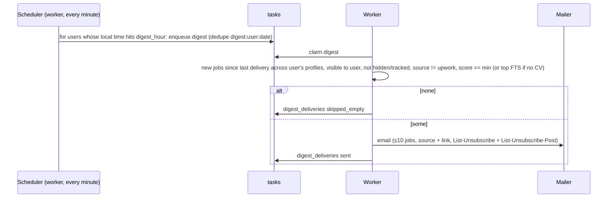

# End-to-end flow: individual job seeker

Covers sign-up → onboarding → CV → search profile → connect platforms → run search → unified results → fit
scores → tracker → daily digest. Screens use static-export routes: no dynamic segments, ids in query params
(see ARCHITECTURE §3).

## 1. Journey overview

```mermaid
flowchart TD
  A[Landing / public jobs browse] -->|Sign up| B[/signup/]
  B --> C[Verify email banner + email link /verify-email?token=]
  B --> D[/onboarding step 1: country, timezone, language/]
  D --> E[step 2: upload CV + AI consent]
  E -->|extracting in background| F[step 3: first search profile prefilled from CV]
  E -->|skip| F
  F --> G[step 4: connect platforms]
  G -->|pair runner / Adzuna key / Upwork info| G
  G --> H[step 5: run first search]
  H --> I[/profiles/view?id= unified results/]
  I -->|Score with CV| J[scores + reasons on cards]
  I -->|Save / Applied| K[/tracker/]
  I -->|Search Upwork now (if enabled)| U[Upwork live panel, 24h]
  K --> L[Daily digest email at local hour]
  L -->|open job| I
  L -->|unsubscribe| M[/unsubscribed/]
```

## 2. Screens (sitemap)

| Route | Auth | Purpose | Key states |
|---|---|---|---|
| `/` | public | Browse the public catalogue (search, source filter, remote), source status strip; CTA "Sign up to match jobs to your CV" | loading skeleton · results · empty · API down banner |
| `/jobs/view?id=` | public* | Job detail: description (text), source badge + link to original, open-to label, Save / Applied buttons (signed in) | not found (also when not visible to you) |
| `/signup`, `/login` | guest | Forms | field errors · 429 "Too many attempts, retry in Ns" · success redirect (`next` param, same-origin only) |
| `/verify-email?token=` | any | Confirms email | verifying · verified · expired/used (resend button) |
| `/forgot-password`, `/reset-password?token=` | guest | Reset | always-same confirmation · expired token |
| `/onboarding` | user | 5-step wizard (`?step=1..5`) | resumable · skip step · finish |
| `/profiles` | user | List of profiles + "New profile"; per profile: last run, new jobs count, best score | empty (CTA) · limit reached (20) |
| `/profiles/new`, `/profiles/edit?id=` | user | Profile form (name, keywords with syntax help, locations, remote-only, based-in, sources checklist grouped by kind) | validation · saving · saved |
| `/profiles/view?id=` | user | **Unified results** (filters, run search, score with CV, Upwork live panel, deep links) | see §4 |
| `/cvs` | user | Upload, list, CV detail (extracted profile), delete | uploading · extracting · ready · failed (retry) · quota |
| `/connections` | user | Platform cards (Built-in, Adzuna, Upwork, Runner + per-site status), MCP tokens | see §5 |
| `/tracker` | user | Board (columns by status) + list view; card drawer with notes, next action, history | empty · drag/drop · keyboard move |
| `/settings` | user | Account (name, country, timezone, language), password, digest, privacy (export, withdraw AI consent, delete account) | confirm dialogs |
| `/privacy`, `/terms` | public | Legal pages | – |
| `/unsubscribed` | public | Digest unsubscribe confirmation | ok · invalid token |

\* Public for public-catalogue jobs; runner-owned jobs only for their owner.

Global layout: top nav (Jobs, Profiles, Tracker, Connections, CVs, user menu), verify-email banner, toast
area, footer (Privacy, Terms, source attributions incl. "Jobs by Adzuna"). A 401 from any call redirects to
`/login?next=<current>`.

## 3. Sign-up, verification and onboarding

```mermaid
sequenceDiagram
  actor U as User
  participant W as SPA
  participant A as API
  participant M as Mailer
  U->>W: /signup (email, password, accept terms+privacy)
  W->>A: POST /api/auth/register
  alt email taken / weak password
    A-->>W: 409 / 400 {error.fields}
    W-->>U: inline errors
  else ok
    A->>M: verification email (24h link)
    A-->>W: 201 + Set-Cookie ujc_session, ujc_csrf
    W->>W: /onboarding?step=1
  end
  U->>W: country VN, timezone, language vi
  W->>A: PATCH /api/me/settings
  U->>W: step 2: upload cv.pdf + tick AI consent
  W->>A: POST /api/cvs (multipart) -> 202 {cvId, taskId}
  W->>A: GET /api/tasks/{taskId} (poll 2s)
  A-->>W: running {step: "extracting"} ... done
  W->>A: GET /api/cvs/{cvId} -> extracted {targetTitles, skills}
  U->>W: step 3: profile prefilled "Next.js developer" -senior, remote, based in VN
  W->>A: POST /api/profiles -> {id}
  U->>W: step 4: connections (optional; same components as /connections)
  U->>W: step 5: "Find jobs"
  W->>A: POST /api/profiles/{id}/search -> 202 {taskId}
  W->>W: /profiles/view?id=..&task=..
```

Onboarding state: `users.onboarding_step` is not needed. The wizard derives the step from the data
(settings set? CV exists? profile exists?) plus `localStorage` for skipped steps. This keeps the API simple.
Users who skip everything land on `/profiles` with the empty state CTA.

Error cases:
- Upload > 5 MB or wrong type → 413/422 inline, nothing stored.
- AI consent not ticked → upload button disabled. Without consent the CV step can be skipped and the user still
  gets keyword results without scores.
- Extraction fails (scanned PDF and OCR fails, provider down) → CV shows Failed with Retry. Onboarding continues;
  the profile form is not prefilled.
- LLM daily quota reached → 429 with reset time. Onboarding continues.
- Email not verified → everything works, but digests are not sent until verified (banner explains).

## 4. Unified results (`/profiles/view?id=`)

Layout:
1. Header: profile name, keywords, chips (based in, remote-only, sources), Edit, **Run search now**, last
   run summary per source ("Himalayas 34 · Remotive 5 · LinkedIn (runner) 21 · 2 h ago").
2. Toolbar: text filter, source multi-select, remote toggle, min-score slider, status filter (Not saved / Saved
   / Applied / Hidden), CV selector + **Score with CV**.
3. Result list (50/page): `JobCard` with SourceBadge, open-to label, MatchBadge (score), summary line,
   missing skills chips, application status badge, actions (Save, Applied, Hide, Open original, 👍/👎 relevance).
4. Side panels:
   - **Upwork (live)**, only if `UPWORK_ENABLED` and connected. "Search Upwork now" uses the profile keywords
     and shows results attributed "From Upwork", with "expires in 23 h", no scores, and Save-to-tracker.
   - **Search elsewhere**: deep links (LinkedIn, Seek, Glassdoor, Arc, YC, Upwork search).

```mermaid
sequenceDiagram
  actor U
  participant W as SPA
  participant A as API
  participant Q as tasks (Postgres)
  participant K as Worker
  participant P as Public APIs (Himalayas, Remotive, Adzuna)
  participant R as Runner
  U->>W: Run search now
  W->>A: POST /api/profiles/7/search
  A->>Q: enqueue profile_search (dedupe_key profile_search:7)
  A-->>W: 202 {taskId} (or existing taskId if already running)
  opt user has an active runner and session sources selected
    A->>A: create runner_request(profile 7)
  end
  K->>Q: claim (SKIP LOCKED)
  K->>P: keyword searches (rate-limited, Remotive cap)
  K->>Q: upsert jobs, link profile_jobs, crawl_runs(user, profile, manual); done
  R->>A: GET /api/runner/assignments (sees request)
  R->>A: POST /api/runner/results (owner-scoped jobs)
  W->>A: GET /api/tasks/{id} ... done
  W->>A: GET /api/profiles/7/jobs?page=1
  U->>W: Score with CV "cv-2026.pdf"
  W->>A: POST /api/profiles/7/match {cvId, limit: 24} -> 202
  K->>K: prefilter -> LLM batches of 8 (excludes source=upwork)
  W->>A: poll task -> GET /api/profiles/7/jobs?cvId=.. (sorted by score)
```

States and errors:

| State | UI |
|---|---|
| First visit, no runs yet | Empty state: "We're searching…" if a task is running, otherwise "Run search now" plus tips |
| Task running | Progress bar per source (from `tasks.progress`); list refreshes when done; button disabled |
| Some sources failed | Yellow notice listing the sources and their errors ("Remotive: daily limit reached, try tomorrow"); results from the others still shown |
| Runner offline | Notice "Your runner was last seen 3 days ago: LinkedIn/Seek results may be stale" with a link to Connections |
| Runner needs login / check | Notice "Seek needs you: open your runner window" (from `site_status`) |
| No results | Suggestions: remove `-` terms, add locations, enable more sources, check "based in" filter |
| Scoring in progress | Cards show a "scoring…" shimmer on the badge; partial results appear per batch |
| Quota reached | Toast with reset time; button disabled until reset |
| API down | Top banner "Can't reach the server, retrying" with exponential backoff |

## 5. Connect platforms (`/connections`)

| Card | States | Actions |
|---|---|---|
| Built-in sources (WWR, Greenhouse/Lever/Ashby, Himalayas, Remotive) | Always on · last global crawl time · errors | none (info + attribution) |
| Adzuna | Built-in (operator key) · Your key connected (`••••1a2b`) · Invalid key | Add key (verified) · Remove |
| Upwork, before approval / disabled | "In-app Upwork search is coming" | "Use Upwork in Claude" (official MCP setup guide) · "Search on Upwork" deep link |
| Upwork, enabled | Not connected · Connected as *name* · Expired (re-connect) | Connect (OAuth) · Disconnect |
| Companion runner | No runner · Pairing (code shown, countdown) · Paired (name, last seen, version) · Offline > 26 h | Add runner · Revoke · copy commands |
| Runner sites (LinkedIn, Seek, Glassdoor, Arc) | Logged in · Needs login · Needs attention (check) · Unknown | shows the exact command `job-crawler-runner login seek` |
| Claude (MCP) | No tokens · tokens list (name, last used) | Create token (shown once) · Revoke · copy Claude config JSON |

Runner pairing UX: the user first ticks "I understand LinkedIn/Seek/Glassdoor/Arc forbid automated access and my
account could be restricted; crawling runs slowly on my own computer". The code `ABCD-EFGH` is then shown with a
10-minute countdown and three copy-paste commands (install, pair, login). The card polls `GET /api/runners` every
3s until paired. Error cases: code expired (generate again), runner version too old (426 from the API with an
upgrade message), runner token revoked (runner prints "This runner was revoked, pair again").

Upwork OAuth error cases:
- user denies → `/connections?upwork=denied`;
- `state` mismatch → 400 page;
- token refresh fails (refresh token older than 2 weeks unused) → status `error`, card shows "Re-connect";
- 429 from Upwork → toast "Upwork is busy, retry in N s".

## 6. Tracker (`/tracker`)

Columns: Saved → Applied → Interviewing → Offer, plus Rejected/Withdrawn (collapsed). Hidden jobs are not shown.
Cards show title, company, source badge, score (if any), next-action date, and days in status. Dragging a card
(or using the keyboard "Move to…" menu) calls `PATCH /api/applications/{id} {status}`. That records an event,
and `applied_at` is set the first time the card reaches Applied. "Add manually" creates an entry from URL,
title and company. Errors: 409 if the job is already tracked (the existing card opens), 404 if the job was
deleted (the snapshot still shows).

## 7. Daily digest



Preconditions: email verified, `digest_enabled`, and `digest_email` consent. The digest does not trigger new
scoring; it uses scores that already exist. Optionally the scheduler runs `profile_search` + `match_score` for
the user's profiles one hour before their digest hour, within quota (decision in M4-08; default on for
profiles with a CV).

## 8. Personal Claude (MCP) flow

1. `/connections` → Claude (MCP) → Create token "Claude Desktop" (scopes `jobs:read profiles:read
   applications:write`).
2. Copy the config snippet into Claude Desktop / Claude Code:
   `{"mcpServers": {"ujc": {"command": "uvx", "args": ["--from", "<repo>/apps/mcp", "ujc-mcp"], "env": {"UJC_API_URL": "https://host", "UJC_TOKEN": "<pat>"}}, "upwork": {"type": "http", "url": "https://mcp.upwork.com/mcp"}}}`
   (exact syntax per client documented in `apps/mcp/README.md`).
3. In Claude: "Find remote Next.js roles open to Vietnam from my profile 'Next.js remote', and also check Upwork
   contracts". Claude calls `ujc.search_jobs` and Upwork's official tools separately. Upwork data stays in the
   user's Claude session and never passes through our server.
4. "Mark the Canva one as applied" → `ujc.update_application`.

## 9. Account deletion & export

Settings → Privacy:
- **Export**: `GET /api/me/export` downloads JSON with profile, settings, profiles, CVs (text + extracted),
  matches, applications + events, connections (platform names only), runners, consents.
- **Delete account**: dialog with password and the typed word DELETE → `DELETE /api/me` →
  - cascade delete;
  - Upwork token revoked at Upwork (best effort);
  - session cleared and redirect to `/` with a toast.

  The runner gets 401 on its next call and tells the user to remove local profiles with
  `job-crawler-runner forget`.
